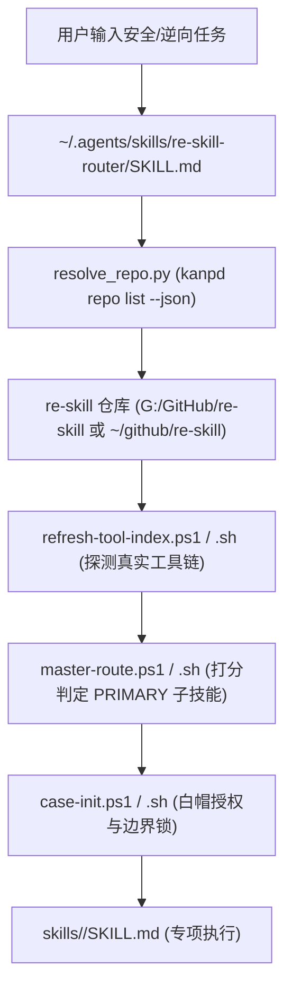

# re-skill-router 架构维护与接入规范

## 方案概述

本方案解决了安全逆向工程套件 `re-skill`（多技能 Monorepo）与全局 Agent 技能体系（`~/.agents/skills/` 单体 Atomic Skill 标准）之间的解耦与接入问题。

### 核心结论与架构决策
1. **边界隔离（零侵入）**：`re-skill` 仓库本身定位为“多技能集合套件与工具链引擎”，保持上游代码纯粹性；在全局 `~/.agents/skills/` 侧创建独立的单体路由技能 `re-skill-router`，承担调度跳板职责，对 `re-skill` 内部业务与脚本代码做零修改。
2. **动态拓扑寻址（免硬编码）**：废弃所有硬编码绝对路径（如 `G:\...` 或 `/Users/...`），单体 Skill 内部通过 `kanpd repo list --json` 动态查询 `re_skill` / `re-skill` 注册路径，并辅以 `RE_SKILL_ROOT` 环境变量与平台标准路径兜底，完全兼容 Windows 与 macOS/Linux。
3. **工程规范多端对齐**：使用 `/setup-project-structure` 分别在 Windows 宿主机与 macOS（`mac-horde`）上对 `re-skill` 进行注册，自动化建立 `.agents/`、`.claude/` 代理目录、`.kanpd/docs` 软链以及 `~/.kanpd/config.toml` 拓扑。
4. **统一 Fork 与 Issue 路由**：完成 GitHub Fork 并托管于 `DaqiHu/re-skill`，配置 `origin` 为该 Fork，`upstream` 为原始上游 `zhaoxuya520/reverse-skill`；同时将两端的 GitHub CLI 默认工作仓库绑定为 `DaqiHu/re-skill`（`gh repo set-default DaqiHu/re-skill`）。

当前状态：Windows 与 macOS 两端已全链路部署、测试通过，`master-route` 动态调用正常，Linter 审计合规。

---

## 架构背景与设计取舍

### 1. 为什么不能直接将套件拷贝到 `~/.agents/skills/`？
- **规范不兼容**：`~/.agents/skills/` 要求每个子目录必须是具备独立自包含 `SKILL.md` 的 Atomic Skill，并受 `linter` 的 `skill-authoring` 规则严格管控（Frontmatter 与主体必须纯英文、禁止硬编码用户目录路径）。
- **相对路径断裂**：`re-skill` 内部各专项技能（如 `apk-reverse`、`ida-reverse` 等）强依赖父级共享的 `../scripts/`、`../tool-index.md` 与 `../../work/` 目录。脱离套件独立抽离将导致工具链和状态丢失。
- **方案取舍**：
  - *方案 A（直接搬迁并魔改）*：重构 40+ 个子技能以适配 `~/.agents` 规范。缺陷：工程量巨大，彻底丧失跟随时钟与上游同步的能力。
  - *方案 B（单体 Adapter 路由桥接 - 采纳）*：在 `~/.agents` 建立合规的单体 Skill `re-skill-router`，仅负责环境感知、动态寻址与任务转派，将复杂业务完全委托给 `re-skill` 套件本身执行。



---

## 单体技能 `re-skill-router` 实现细节

### 1. 目录结构
```text
~/.agents/skills/re-skill-router/
├── SKILL.md                  # 符合规范的英文入口（Agent 行为指导）
└── scripts/
    └── resolve_repo.py       # 跨平台动态拓扑寻址脚本
```

### 2. 动态拓扑寻址实现 (`resolve_repo.py`)
脚本不引入任何第三方依赖，严格基于标准库实现跨平台路径探测：
1. **主干探测**：调用 `kanpd repo list --json`，解析 `repos` 列表，匹配 `key` 为 `re_skill` 或 `re-skill` 的条目路径。
2. **环境变量探测**：读取 `$RE_SKILL_ROOT`。
3. **启发式候选探测**：依次探测常见目录（如 `~/github/re-skill`、`G:/GitHub/re-skill` 等），验证目录下存在 `RULES.md` 和 `skills/` 目录。
4. **输出与校验**：提供 `--verify` 标志，确保返回有效绝对路径。

---

## 多端工程结构注册与 GitHub 协作配置

### 1. Windows 端注册
在 Windows 宿主机上执行工程脚手架初始化：
```powershell
# 1. 注册仓库代理结构与拓扑
uv run C:\Users\hudaq\.agents\skills\setup-project-structure\scripts\setup.py --repo G:\GitHub\re-skill --kanpd-allow-worktree

# 2. 配置 GitHub Fork 与 Remote
gh repo fork --fork-name re-skill --remote
gh repo set-default DaqiHu/re-skill
```
- 在 `C:\Users\hudaq\.kanpd\config.toml` 生成 `[multi_repo.repos.re_skill]`。
- 创建符号链接 `.kanpd/docs -> G:\UGit\GameDesignNotes\5_RepoDocs\re-skill`。
- 将工程路径追加至 `main.code-workspace`。

### 2. macOS 端（`mac-horde`）同步
在 macOS 上通过 SSH 保持一致初始化：
```bash
# 1. 目录对齐与远程仓库更新
mv ~/github/reverse-skill ~/github/re-skill
git remote set-url origin https://github.com/DaqiHu/re-skill.git
git remote set-url upstream https://github.com/zhaoxuya520/reverse-skill.git
git pull origin main

# 2. 默认 GitHub 仓库设置
gh repo set-default DaqiHu/re-skill

# 3. 运行工程结构初始化
uv run ~/.agents/skills/setup-project-structure/scripts/setup.py --repo ~/github/re-skill --kanpd-allow-worktree
```
- 在 macOS 端 `~/.kanpd/config.toml` 完成拓扑收录。
- 建立软链 `~/.kanpd/docs -> /Users/hudaqi/ugit/GameDesignNotes/5_RepoDocs/re-skill`。

---

## 验证与测试记录

### 1. 动态寻址与功能调用验证
- **Windows 测试**：
  ```powershell
  $repo = python C:\Users\hudaq\.agents\skills\re-skill-router\scripts\resolve_repo.py
  powershell -NoProfile -ExecutionPolicy Bypass -File "$repo\skills\scripts\master-route.ps1" -Hint "分析一个APK的加固和登录协议"
  ```
  - 寻址结果：`G:\GitHub\re-skill`
  - 路由输出：`PRIMARY -> skills/apk-reverse/SKILL.md (confidence: high)`
- **macOS 测试**：
  ```bash
  repo=$(python3 ~/.agents/skills/re-skill-router/scripts/resolve_repo.py)
  bash "$repo/skills/scripts/master-route.sh" --hint "测试APK逆向"
  ```
  - 寻址结果：`/Users/hudaqi/github/re-skill`
  - 路由输出：正常解析，生成测试 scope 文件。

### 2. 规范与 Linter 验证
- **纯英文 Frontmatter 与 Body**：正则匹配 `[\u4e00-\u9fa5]` 结果为 0。
- **无硬编码绝对路径**：正则匹配 `C:\Users` 与 `/Users/` 结果为 0。
- **Git 远端验证**：
  - Windows `git remote -v` 与 Mac `git remote -v` 均显示 `origin: DaqiHu/re-skill`，`upstream: zhaoxuya520/reverse-skill`。
  - `gh repo set-default --view` 两端均输出 `DaqiHu/re-skill`。

---

## References

- 单体路由 Skill 入口：
  - [SKILL.md](file:///C:/Users/hudaq/.agents/skills/re-skill-router/SKILL.md#L1-L50)
- 动态拓扑寻址脚本：
  - [resolve_repo.py](file:///C:/Users/hudaq/.agents/skills/re-skill-router/scripts/resolve_repo.py#L1-L70)
- `re-skill` 仓库全局行为准则：
  - [RULES.md](file:///G:/GitHub/re-skill/RULES.md#L1-L25)
- `re-skill` 平台无关 Agent 入口：
  - [AGENTS.md](file:///G:/GitHub/re-skill/AGENTS.md#L1-L35)
- 原生路由映射规则事实源：
  - [routing.json](file:///G:/GitHub/re-skill/skills/config/routing.json#L1-L40)
- kanpd 拓扑注册项：
  - `C:\Users\hudaq\.kanpd\config.toml`: `[multi_repo.repos.re_skill]`
